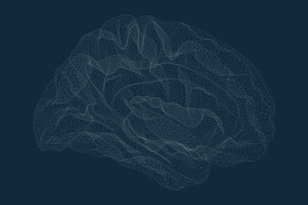
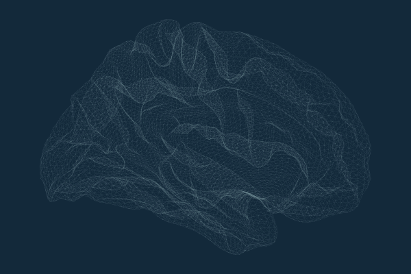
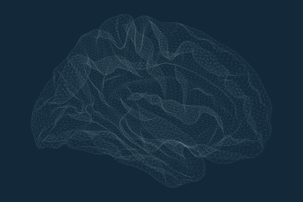
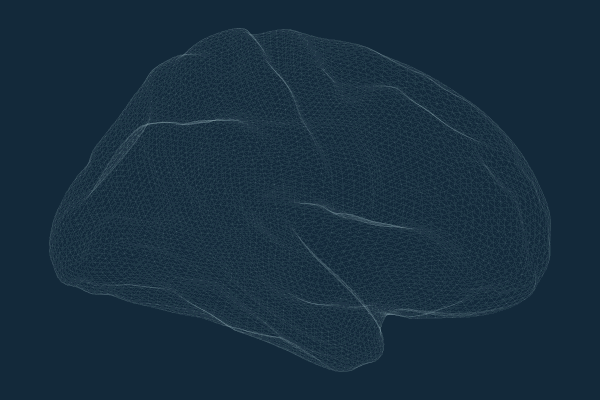
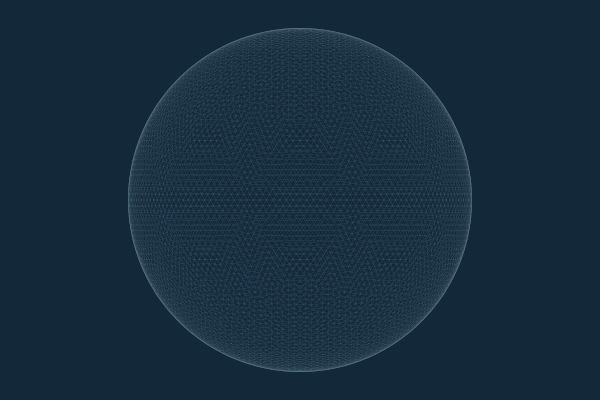
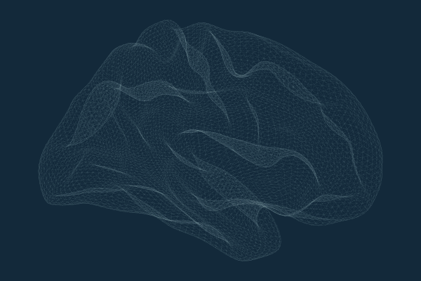
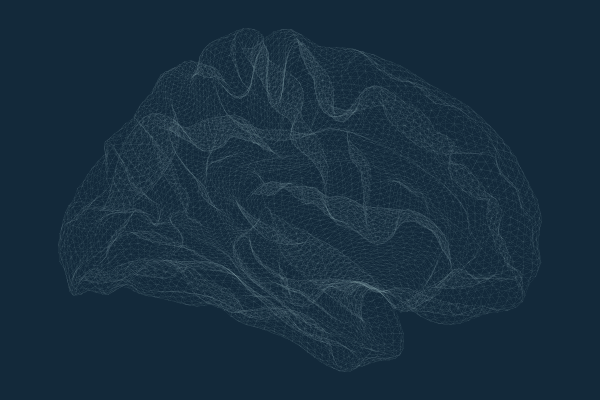
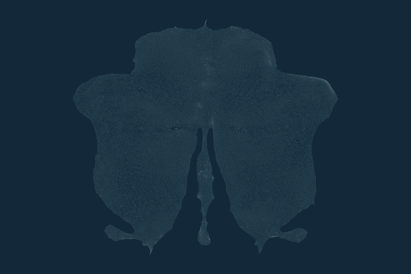

# Introduction to ggseg.meshes

The ggseg ecosystem uses brain surface meshes to render atlas
parcellations in 3D. The core packages ship with the inflated cortical
mesh (in ggseg.formats) and the SUIT 3D pial cerebellar mesh.
ggseg.meshes extends this with additional surfaces for both cortical and
cerebellar visualisation.

## Available surfaces

### Cortical

All cortical meshes are fsaverage5 resolution: 10,242 vertices and
20,480 triangular faces per hemisphere.

``` r

available_cortical_surfaces()
#> [1] "pial"          "white"         "midthickness"  "semi-inflated"
#> [5] "sphere"        "smoothwm"      "orig"
```

| Surface | Description | Use case |
|----|----|----|
| **pial** | Grey matter / CSF boundary | Anatomically accurate rendering |
| **white** | Grey / white matter boundary | White matter surface visualisation |
| **midthickness** | Midpoint of pial + white | HCP-style analyses, functional data sampling |
| **semi-inflated** | 35/65 blend of white + inflated | Compromise between anatomical accuracy and visibility |
| **sphere** | Spherical registration surface | Surface-based registration, QC |
| **smoothwm** | Smoothed white matter | Smoother alternative to white surface |
| **orig** | Pre-topology-correction surface | Debugging surface reconstruction |

|  |  |  |
|:--:|:--:|:--:|
|  |  |  |
| pial | white | midthickness |
|  |  |  |
| semi-inflated | sphere | smoothwm |
|  |  |  |
| orig |  |  |

### Cerebellar

``` r

available_cerebellar_surfaces()
#> [1] "suit_flat"
```

The SUIT flatmap is a 2D flattened projection of the cerebellar cortex
with 28,935 vertices. Its relationship to the SUIT 3D pial mesh in
ggseg.formats – which vertex indices carry over, and which cannot be
drawn – is documented in full at
[`?get_cerebellar_flatmap`](https://ggsegverse.github.io/ggseg.meshes/reference/get_cerebellar_flatmap.md),
which is the authority for that correspondence.



SUIT cerebellar flatmap

## Accessing meshes

Each mesh is a list with `vertices` (data.frame: x, y, z) and `faces`
(data.frame: i, j, k). The cortical coordinates are rotated 90 degrees
from FreeSurfer’s native axes, so `x` is anterior-posterior and `y` is
left-right; see
[`?get_cortical_mesh`](https://ggsegverse.github.io/ggseg.meshes/reference/get_cortical_mesh.md)
for the full convention.

``` r

mesh <- get_cortical_mesh("lh", "pial")
head(mesh$vertices)
#>              x         y         z
#> 1 -19.34336472 38.735958 67.220139
#> 2 -69.06122589 16.662487 61.281273
#> 3  -9.23326397  9.717618 46.580341
#> 4  43.11487198 24.019428 23.926214
#> 5   0.04929276 59.861500  8.974564
#> 6 -49.40507889 50.645546 47.813751
head(mesh$faces)
#>   i    j    k
#> 1 1 2565 2563
#> 2 1 2563 2566
#> 3 1 2566 2568
#> 4 1 2568 2570
#> 5 1 2570 2565
#> 6 4 2575 2573
```

``` r

flat <- get_cerebellar_flatmap()
nrow(flat$vertices)
#> [1] 28935
nrow(flat$faces)
#> [1] 56588
```

## Integration with ggseg3d

When ggseg.meshes is installed, `ggseg3d::resolve_brain_mesh()` can
resolve all surfaces provided by this package. This means you can render
atlases on any surface:

``` r

library(ggseg3d)

ggseg3d(atlas = dk(), surface = "pial") |>
  pan_camera("left lateral")

ggseg3d(atlas = dk(), surface = "white") |>
  pan_camera("left lateral")
```

## Mesh structure

All cortical meshes here share one face table, byte-for-byte, so vertex
indices from cortical atlases work with any of them – the same vertex
index refers to the same anatomical location across pial, white,
semi-inflated, sphere, and the rest.

That face table describes the same triangle connectivity as the inflated
mesh in ggseg.formats, but the two are **not** interchangeable as
written: the ggseg.formats faces are 0-based and these are 1-based.
`ggseg.formats::get_brain_mesh("lh")$faces + 1` is exactly the face
table returned here. Read the `face_index_base` attribute rather than
assuming a base, on either side.

``` r

vapply(
  available_cortical_surfaces(),
  function(s) {
    mesh <- get_cortical_mesh("lh", s)
    c(vertices = nrow(mesh$vertices), faces = nrow(mesh$faces))
  },
  integer(2)
)
#>           pial white midthickness semi-inflated sphere smoothwm  orig
#> vertices 10242 10242        10242         10242  10242    10242 10242
#> faces    20480 20480        20480         20480  20480    20480 20480
```
